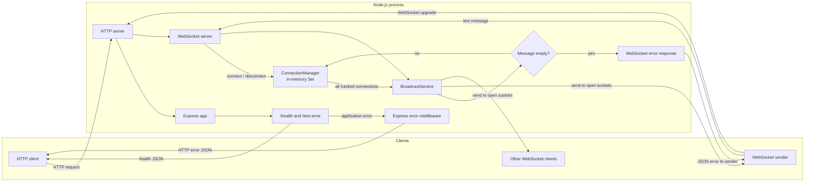

# Broadcast Server

A small Node.js service that exposes an HTTP health endpoint and a WebSocket
endpoint on the same port. WebSocket clients can send a text message and the
server broadcasts it to every connected client whose connection is open.

## Architecture and data flow



### WebSocket message flow

1. A client opens a WebSocket connection to the HTTP server. The
   `ConnectionManager` adds the socket to an in-memory `Set`.
2. When a client sends a message, the WebSocket server passes its text to the
   `BroadcastService`.
3. The service rejects empty or whitespace-only messages. The sender receives
   a JSON error such as `{"success":false,"message":"Message cannot be empty"}`.
4. For a valid message, the service sends the original text to every open
   socket in the set, including the sending client. Closed/non-open sockets are
   skipped. A socket is removed from the set if sending throws.
5. On disconnect, the socket is removed from the set.

Connections and messages are held only in process memory. The service does not
currently authenticate clients, persist messages, or publish through Supabase.
The Supabase client module and related environment settings are present, but
they are not part of the active broadcast flow.

## Requirements

- Node.js 20 or newer
- npm

## Setup

```sh
npm ci
```

Create a local `.env` file from the example:

```sh
cp .env.example .env
```

On Windows PowerShell, use:

```powershell
Copy-Item .env.example .env
```

Set the following values in `.env`:

| Variable | Required | Description |
| --- | --- | --- |
| `PORT` | No | HTTP and WebSocket port. Defaults to `8080`. |
| `SUPABASE_URL` | Yes | Supabase project URL. |
| `SUPABASE_PUBLISHABLE_KEY` | Yes | Supabase publishable key used by the configured client. |
| `SUPABASE_JWKS_URL` | Yes | Supabase JWKS URL. Required by configuration, but not currently used by the broadcast flow. |
| `SUPABASE_SECRET_KEY` | No | Optional secret key setting; not currently used by the broadcast flow. Keep secrets out of source control. |

The server validates the required Supabase URL, publishable key, and JWKS URL
at startup even though Supabase is not currently connected to message
broadcasting. Do not use a secret/service key as the publishable key.

## Run

Start the service:

```sh
npm start
```

Or use the CLI:

```sh
node cli/index.js start
```

The server listens on `http://localhost:8080` by default (or the configured
`PORT`). The WebSocket endpoint uses the same host and port:
`ws://localhost:8080`.

The CLI also provides a sample WebSocket client:

```sh
node cli/index.js connect
```

That sample currently connects to `ws://localhost:8000` and sends
`Hello Server!`. To use it with the default server configuration, set
`PORT=8000` in `.env`; otherwise connect with a WebSocket client pointed at the
configured port.

## HTTP endpoints

| Method | Path | Behavior |
| --- | --- | --- |
| `GET` | `/health` | Returns `{"success":true,"message":"ok working"}`. |
| `GET` | `/test-error` | Test endpoint that returns an HTTP 400 error response. |

Unexpected HTTP errors are logged and returned as a generic
`{"success":false,"message":"Internal server error"}` response.

## Testing

Run the Jest test suite:

```sh
npm test
```

Tests cover the health and error endpoints, asynchronous error forwarding,
WebSocket connections, message fan-out, empty-message rejection, and handling
of clients that are closed or fail to receive a message.

## Project layout

```text
cli/
  index.js                         # CLI commands: start and connect
src/
  app.js                           # Express app and HTTP routes
  server.js                        # HTTP/WebSocket server lifecycle
  config/
    env.js                         # dotenv loading and config validation
    supabase.js                    # Supabase client setup
  middleware/
    async-handler.js               # Async Express handler wrapper
    error-handler.js               # Central HTTP error response handler
  service/
    broadcast.service.js            # Validation and WebSocket fan-out
  utils/
    app-error.js                   # Operational application error type
  websocket/
    connection-manager.js          # In-memory active connection registry
    websocket.server.js            # WebSocket events and service wiring
    websocket-error-handler.js     # WebSocket error responses
    test-client.js                 # Sample local WebSocket client
tests/                              # Jest tests
```

The server handles `SIGINT` and `SIGTERM` by closing connected WebSocket
clients, then the WebSocket server, and finally the HTTP server.